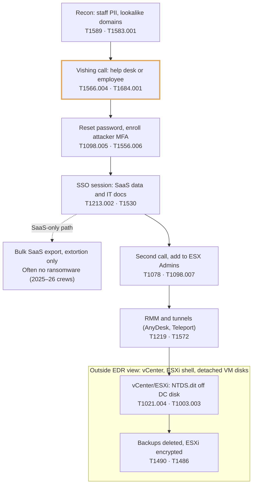

# Scattered Spider (G1015) — Threat Actor Profile

> **A red & purple team–oriented adversary profile** · November 21, 2026 · Author: Jessie Parker
>
> Classification: **TLP:CLEAR** — compiled from open-source intelligence for portfolio and training use.

**Contents:** [Executive Summary](#executive-summary) · [Group Overview & Attribution](#group-overview--attribution) · [Targeting & Victimology](#targeting--victimology) · [Attack Lifecycle](#attack-lifecycle) · [Malware & Tooling Arsenal](#malware--tooling-arsenal) · [Notable Campaigns](#notable-campaigns) · [Adversary Emulation Playbook](#adversary-emulation-playbook-red-team) · [Detection & Hunting](#detection--hunting-opportunities-purple--blue) · [ATT&CK Technique Matrix](#attck-technique-matrix) · [Assessment, Mitigations & References](#assessment-mitigations--references)

---

## Executive Summary

Scattered Spider (MITRE G1015) is a financially motivated, English-speaking cybercrime collective that has breached hundreds of large organizations since 2022 by talking its way in rather than exploiting software. Its signature move is calling an IT help desk as an employee, getting a password and MFA reset, and turning that one identity into SSO, Active Directory and hypervisor control within hours.

The group's record runs from the 2022 "0ktapus" SMS-phishing campaign against 136 organizations, through the 2023 MGM Resorts and Caesars attacks and the 2024 Transport for London breach, to the 2025 UK retail wave (Marks & Spencer, Co-op, Harrods) that put DragonForce ransomware on VMware ESXi. Law enforcement has since landed heavy blows: two UK members were jailed for five and a half years each in July 2026, and the last of five US defendants was sentenced in November 2026. The playbook outlived the arrests, though. CrowdStrike tracks CORDIAL SPIDER and SNARKY SPIDER as the "new generation of Scattered Spider," running the same SSO vishing since October 2025.

For a red or purple team, this is the clearest example of an identity-first adversary. Most stages drop no malware, so the detections that matter live in help desk workflows, identity-provider audit logs, Active Directory group changes and vCenter/ESXi logs, not only endpoint telemetry. This profile covers attribution, targeting, the attack lifecycle, tooling, a campaign timeline, an emulation playbook and detection opportunities for a Sysmon/Wazuh lab extended with identity and virtualization logs.

## Group Overview & Attribution

Scattered Spider is less a single team than a brand for overlapping crews drawn from "the Com," a loose online ecosystem of mostly teenage and young-adult English speakers in the US and UK. Vendors track it under many names, and MITRE consolidates them as G1015.

| Attribute | Assessment |
| --- | --- |
| Aliases | UNC3944 (Mandiant), Octo Tempest (Microsoft), Muddled Libra (Unit 42), Scatter Swine (Okta), 0ktapus (Group-IB), Storm-0875, LUCR-3, Star Fraud |
| Active since | Early 2022 (continuous; successor crews since October 2025) |
| Suspected origin | United States and United Kingdom; native English speakers within the Com |
| Primary motivation | Financial: data-theft extortion, ransomware affiliate payouts, SIM-swap crypto theft |
| Sophistication | Low malware sophistication, very high social-engineering and identity tradecraft |
| Ransomware partners | ALPHV/BlackCat (2023), RansomHub and Qilin (2024), DragonForce (2025) |

Attribution confidence is unusually high for a criminal actor because it rests on court records rather than infrastructure overlap. In the US case over the 2021–2023 smishing and SIM-swap scheme, all five defendants are now sentenced: Noah Urban to 10 years, Tyler Buchanan to six years in November 2026, and three others to between two years and 45 months ([SecurityWeek](https://www.securityweek.com/last-of-five-defendants-sentenced-in-us-scattered-spider-hacking-case/)). In the UK, Thalha Jubair and Owen Flowers each received five years and six months on 16 July 2026 for the Transport for London attack; the NCA described them as leading members and said its action "effectively halted" the group ([National Crime Agency](https://www.nationalcrimeagency.gov.uk/news/two-sentenced-for-hacking-transport-for-london-in-uk-s-biggest-ever-cyber-crime-case)). A separate US complaint alleges Jubair took part in 120 intrusions at 47 US entities that drew at least \$115 million in ransoms ([KrebsOnSecurity](https://krebsonsecurity.com/2026/06/scattered-spider-hackers-plead-guilty-on-day-1-of-trial/)), and an alleged member, a 19-year-old US-Estonian citizen, was extradited from Finland in June 2026 over an \$8 million extortion attempt against a luxury jewelry retailer ([US DOJ](https://www.justice.gov/opa/pr/alleged-member-criminal-cyber-hacking-group-scattered-spider-arrested-finland-and-extradited)).

The hard part is the boundary, not the identity. Since August 2025, Scattered Spider members have posted alongside ShinyHunters and LAPSUS\$ under the "Scattered LAPSUS\$ Hunters" (SLSH) banner, and the Salesforce data-theft campaigns (UNC6040, UNC6395) and the 2026 SSO vishing clusters (UNC6661, UNC6671) sit inside that coalition rather than cleanly within Scattered Spider. CrowdStrike calls CORDIAL SPIDER and SNARKY SPIDER the group's "new generation" but notes they lack its technical depth ([CyberScoop](https://cyberscoop.com/crowdstrike-cordial-spider-snarky-spider-extortion-attacks/)). Treat "Scattered Spider" in 2026 reporting as a tradecraft label as much as a membership roster; this profile flags where an attribution rests on a public claim rather than evidence.

## Targeting & Victimology

Scattered Spider picks victims by identity attack surface, not geography: large organizations with big help desks, SSO portals and valuable SaaS data. Microsoft observed that the group works one industry for several weeks or months before moving on; between April and July 2025 it ran from retail and food services through hospitality and insurance to airlines ([Microsoft](https://microsoft.com/en-us/security/blog/2025/07/16/protecting-customers-from-octo-tempest-attacks-across-multiple-industries)).

Those waves trace the group's history. Early campaigns hit telecom, business-process outsourcing (BPO), technology and crypto firms, where help desk access and phone-number control paid off directly ([CrowdStrike](https://www.crowdstrike.com/en-us/adversaries/scattered-spider/)). 2023 brought casinos and hospitality, 2024 transport and healthcare, and 2025 UK retail, US insurance and aviation. Victims are concentrated in the US and UK, with reported reach into Canada and Australia (Qantas). Successor crews in 2026 target US academic, aviation, retail, hospitality, automotive, financial, legal and technology organizations ([CyberScoop](https://cyberscoop.com/crowdstrike-cordial-spider-snarky-spider-extortion-attacks/)).

Third parties are a deliberate entry point. CISA warns the group abuses trusted relationships with contracted IT help desks, and Unit 42 notes it targets outsourced call centers at BPOs and MSPs ([CISA](https://www.cisa.gov/news-events/cybersecurity-advisories/aa23-320a), [Unit 42](https://unit42.paloaltonetworks.com/muddled-libra-ops-playbook/)). Healthcare is in scope too: Owen Flowers was reportedly hacking SSM Health Care and Sutter Health when he was arrested in September 2024 ([National Crime Agency](https://www.nationalcrimeagency.gov.uk/news/two-sentenced-for-hacking-transport-for-london-in-uk-s-biggest-ever-cyber-crime-case)).

The takeaway for defenders and emulation planners: the target is the reset process, and any organization whose help desk can restore access by phone is exposed regardless of sector.

## Attack Lifecycle

Scattered Spider's chain is identity-first: it runs from a phone call to the identity provider, then to Active Directory, then down to the hypervisor, where endpoint tools have little visibility. Successor crews often stop after the SaaS stage and extort stolen data instead. The stages below are mapped to MITRE ATT&CK.



*A help desk call is the only "exploit" in the chain. The main path ends in ESXi ransomware; the dashed branch is SaaS-only extortion.*

1. **Reconnaissance — People, not ports (T1589 / T1598.004 / T1583.001).** Operators build dossiers on employees from LinkedIn, breach data and earlier intrusions, gathering PII and security-question answers for high-value users ([CISA](https://www.cisa.gov/news-events/cybersecurity-advisories/aa23-320a)). They register lookalike domains such as `targetsname-helpdesk[.]com` and `oktalogin-targetcompany[.]com` ([ASD's ACSC](https://www.cyber.gov.au/advisory/scattered-spider)).
2. **Initial Access — Vishing the help desk or the employee (T1566.004 / T1684.001 / T1199).** The classic move is calling the help desk as an employee and asking for a password and MFA reset. The 2026 variant reverses it: callers pose as IT, steer the employee to a real-time phishing kit that mimics the corporate SSO page, and relay credentials and MFA codes live ([BleepingComputer](https://www.bleepingcomputer.com/news/security/mandiant-details-how-shinyhunters-abuse-sso-to-steal-cloud-data/)). Earlier campaigns used mass SMS phishing (0ktapus), MFA fatigue (T1621) and SIM swaps (T1111).
3. **Persistence — Own the MFA (T1098.005 / T1556.006 / T1484.002).** Attackers enroll their own MFA device, then delete the notification email so the user never sees it. At MGM they reached Okta Super Administrator and added a rogue identity provider through inbound federation, which let them sign in as other users ([Push Security](https://pushsecurity.com/blog/scattered-lapsus-hunters)). They also create new identities backed by fake social media profiles (T1136 / T1585.001).
4. **Discovery & Collection in SaaS (T1213.002 / T1530 / T1114).** With a live SSO session, they search SharePoint, wikis, Teams and Slack for IT runbooks, VPN guides and admin group names, and bulk-download data from Salesforce, SharePoint and Snowflake, where the July 2025 advisory describes thousands of queries run in quick succession ([ASD's ACSC](https://www.cyber.gov.au/advisory/scattered-spider)). For successor crews this is often the objective; Snarky Spider has started exfiltration in under an hour in observed cases ([Proof](https://www.proof.com/blog/turning-account-recovery-into-a-seven-figure-business)).
5. **Privilege Escalation — The second call (T1078.002 / T1098.007 / T1003.006).** Mandiant describes a second help desk call impersonating a named administrator, followed by WinRM and `net.exe` commands that add the attacker to "ESX Admins" ([Mandiant](https://cloud.google.com/blog/topics/threat-intelligence/defending-vsphere-from-unc3944/)). Microsoft adds LSASS dumping with Mimikatz, suspected DCSync and reading the AD FS DKM key ([Microsoft](https://microsoft.com/en-us/security/blog/2025/07/16/protecting-customers-from-octo-tempest-attacks-across-multiple-industries)). Password vaults and PAM tools are probed for weak controls (T1555.005).
6. **Command & Control — Legitimate remote access and tunnels (T1219 / T1572 / T1090).** AnyDesk, ScreenConnect, TeamViewer and other RMM tools provide hands-on access; ngrok, Chisel, Tailscale and Teleport punch through egress controls; residential proxies and rotating hostnames hide the operators. Defense impairment ranges from EDR tampering to a 2023 BYOVD attempt with the Intel `iqvw64.sys` driver (T1068 / T1685) ([CrowdStrike](https://www.crowdstrike.com/en-us/blog/scattered-spider-attempts-to-avoid-detection-with-bring-your-own-vulnerable-driver-tactic/)).
7. **Hypervisor Takeover — vCenter to NTDS.dit (T1021.004 / T1003.003 / T1564.006).** With vSphere admin rights, operators reboot the vCenter appliance into a root shell, install Teleport as a persistent reverse tunnel, enable SSH on ESXi hosts, power off a domain controller and copy NTDS.dit from its disk through an orphaned VM ([Mandiant](https://cloud.google.com/blog/topics/threat-intelligence/defending-vsphere-from-unc3944/)). Unit 42 saw the group create rogue VMs as an unmonitored beachhead ([Unit 42](https://unit42.paloaltonetworks.com/muddled-libra-ops-playbook/)).
8. **Impact — Backups first, then encryption (T1490 / T1486 / T1567.002).** They delete backup jobs and repositories, push an encryptor to ESXi over SCP, power off VMs with `vim-cmd` and run it under `nohup`. ALPHV encrypted more than 100 MGM hypervisors in 2023, and DragonForce hit Marks & Spencer's ESXi hosts on 24 April 2025 ([BleepingComputer](https://www.bleepingcomputer.com/news/security/marks-and-spencer-breach-linked-to-scattered-spider-ransomware-attack/amp/)). Data goes to MEGA, Amazon S3 or VPS hosts beforehand, and extortion follows over Tox, email or Telegram, sometimes backed by DDoS or swatting of non-payers ([CyberScoop](https://cyberscoop.com/crowdstrike-cordial-spider-snarky-spider-extortion-attacks/)).

## Malware & Tooling Arsenal

Scattered Spider's design philosophy is "live off the victim's land." Where Blind Eagle buys commodity RATs and builds custom loaders, Scattered Spider barely uses malware at all: it signs in with real credentials, then runs the same remote-support, tunneling and admin tools the victim's IT team uses. That makes signature-based detection weak and allowlisting strong.

| Tool | Type | Role in the chain |
| --- | --- | --- |
| Real-time phishing kits (0ktapus kit, 2026 SSO kits) | Adversary-in-the-middle phishing | Mimic Okta, Entra or Google sign-in; relay credentials and MFA codes to the operator live |
| AnyDesk, ScreenConnect, TeamViewer, Splashtop | Commercial remote access | Hands-on-keyboard access that looks like IT support |
| Fleetdeck, Level.io, Pulseway, Tactical RMM | RMM platforms | Redundant persistence across hosts |
| Tailscale, ngrok, Chisel | Tunneling | Inbound access through NAT and egress filtering |
| Teleport | Open-source access proxy | Systemd reverse tunnel from the vCenter appliance (2025) |
| Mimikatz, ADExplorer, ADRecon, AADInternals, GoSecretsDump | Credential and directory tooling | LSASS dumping, AD and Entra enumeration, secrets extraction |
| PsExec, S3 Browser | Admin utilities | Lateral movement; staging data to Amazon S3 |
| RattyRAT | Java-based RAT | Persistent, low-noise access and internal recon (2025 advisory) |
| AveMaria (WarZone), Raccoon, Vidar | Commodity RAT and infostealers | Occasional credential theft (2023 advisory) |
| Intel `iqvw64.sys` (CVE-2015-2291) | Vulnerable signed driver (BYOVD) | Loads a malicious kernel driver that patches EDR in memory |
| ALPHV/BlackCat, RansomHub, Qilin, DragonForce | Ransomware-as-a-service | ESXi-focused encryption as an affiliate |

Sources: [CISA/FBI AA23-320A](https://www.cisa.gov/news-events/cybersecurity-advisories/aa23-320a), [ASD's ACSC July 2025 update](https://www.cyber.gov.au/advisory/scattered-spider), [Microsoft](https://microsoft.com/en-us/security/blog/2025/07/16/protecting-customers-from-octo-tempest-attacks-across-multiple-industries), [Unit 42](https://unit42.paloaltonetworks.com/muddled-libra-ops-playbook/), [CrowdStrike](https://www.crowdstrike.com/en-us/blog/scattered-spider-attempts-to-avoid-detection-with-bring-your-own-vulnerable-driver-tactic/), [Group-IB](https://www.group-ib.com/media-center/press-releases/0ktapus-campaign/).

Two tradecraft notes stand out. First, the group increasingly works where EDR cannot see: Mandiant documented it rebooting the vCenter appliance into a root shell, enabling SSH on ESXi hosts and copying NTDS.dit from a powered-off domain controller's disk, and Unit 42 saw it spin up rogue VMs through vSphere as an unmonitored beachhead ([Mandiant](https://cloud.google.com/blog/topics/threat-intelligence/defending-vsphere-from-unc3944/), [Unit 42](https://unit42.paloaltonetworks.com/muddled-libra-ops-playbook/)). Second, it attacks the victim's own alerting: in 2026 intrusions by UNC6661, a vishing cluster inside the SLSH coalition, operators deleted the "security method enrolled" email and used a Google Workspace add-on to search and purge mail, so the employee never saw the new MFA device ([BleepingComputer](https://www.bleepingcomputer.com/news/security/mandiant-details-how-shinyhunters-abuse-sso-to-steal-cloud-data/)).

## Notable Campaigns

The group's history reads as one entry technique applied to ever larger targets, with the back end swapped as partners and defenses changed. The table lists the campaigns and reports that mark meaningful shifts, oldest first.

| Period | Campaign / Report | Notable change |
| --- | --- | --- |
| Sep 2021–Apr 2023 | SMS phishing and SIM-swap scheme (US case) | At least \$11.6M in crypto stolen; all five US defendants sentenced by Nov 2026 |
| Mar–Aug 2022 | Group-IB: 0ktapus | 136 organizations, 9,931 credentials, 169 Okta-themed phishing domains; Twilio and Cloudflare targeted |
| Jan 2023 | CrowdStrike: BYOVD | Intel driver CVE-2015-2291 used to try to blind EDR |
| Sep 2023 | MGM Resorts and Caesars | Help desk reset to Okta Super Admin and a rogue federated IdP; ALPHV on 100+ ESXi hosts; MGM about \$100M impact; Caesars reportedly paid \$15M |
| Nov 2023 | CISA/FBI AA23-320A | First joint advisory on the group |
| Jul 2024 | Microsoft: new RaaS partners | RansomHub and Qilin adopted after ALPHV's exit |
| Aug–Sep 2024 | Transport for London | 27,000 staff reset passwords in person; 148 systems down; £29M cost |
| Feb–May 2025 | Marks & Spencer, Co-op, Harrods | NTDS.dit taken in February; DragonForce on ESXi on 24 April; M&S about £300M lost profit |
| May–Jul 2025 | Insurance and aviation waves | One sector at a time; Qantas linked |
| Jul 2025 | Mandiant "Help Desk to Hypervisor"; CISA update | vCenter/ESXi playbook, Teleport tunnels, DragonForce, Snowflake bulk exfiltration |
| Aug–Oct 2025 | Scattered LAPSUS\$ Hunters | Coalition with ShinyHunters and LAPSUS\$; Salesforce extortion; claimed JLR attack (unverified) |
| Sep 2025 | Jubair and Flowers charged | US complaint alleges 120 intrusions and \$115M in ransoms |
| Oct 2025 onward | CrowdStrike: CORDIAL and SNARKY SPIDER | "New generation" SSO vishing, MFA swaps, DDoS and swatting of non-payers |
| Jan 2026 | Mandiant: UNC6661 / UNC6671 | Live vishing plus real-time kits against Okta, Entra and Google SSO |
| Jun–Jul 2026 | Extradition and UK sentences | Alleged member extradited from Finland; Jubair and Flowers get 5.5 years each |
| Nov 2026 | Buchanan sentenced | Six years; last of the five US defendants |

Sources: [SecurityWeek](https://www.securityweek.com/last-of-five-defendants-sentenced-in-us-scattered-spider-hacking-case/), [Group-IB](https://www.group-ib.com/media-center/press-releases/0ktapus-campaign/), [CrowdStrike](https://www.crowdstrike.com/en-us/blog/scattered-spider-attempts-to-avoid-detection-with-bring-your-own-vulnerable-driver-tactic/), [Push Security](https://pushsecurity.com/blog/scattered-lapsus-hunters), [BleepingComputer on MGM](https://bleepingcomputer.com/news/security/mgm-resorts-ransomware-attack-led-to-100-million-loss-data-theft/), [Wikipedia](https://en.wikipedia.org/wiki/Scattered_Spider), [Dark Reading](https://darkreading.com/threat-intelligence/microsoft-scattered-spider-widens-web-with-ransomhub-and-qilin), [National Crime Agency](https://www.nationalcrimeagency.gov.uk/news/two-sentenced-for-hacking-transport-for-london-in-uk-s-biggest-ever-cyber-crime-case), [BleepingComputer on M&S](https://www.bleepingcomputer.com/news/security/marks-and-spencer-breach-linked-to-scattered-spider-ransomware-attack/amp/), [Insurance Journal on JLR](https://www.insurancejournal.com/news/international/2025/10/07/842850.htm), [Mandiant](https://cloud.google.com/blog/topics/threat-intelligence/defending-vsphere-from-unc3944/), [CyberScoop](https://cyberscoop.com/crowdstrike-cordial-spider-snarky-spider-extortion-attacks/), [BleepingComputer on UNC6661](https://www.bleepingcomputer.com/news/security/mandiant-details-how-shinyhunters-abuse-sso-to-steal-cloud-data/), [US DOJ](https://www.justice.gov/opa/pr/alleged-member-criminal-cyber-hacking-group-scattered-spider-arrested-finland-and-extradited).

The through-line matters more than any single campaign: tooling, ransomware partners and victims change, but every major intrusion starts with a person on the phone or a text message. The 2025 shift to the hypervisor made the impact far worse, and the 2026 successor crews show the opposite trend, skipping ransomware entirely and extorting stolen SaaS data within hours of a single SSO compromise.

## Adversary Emulation Playbook (Red Team)

This section outlines how to reproduce Scattered Spider's behavior inside a contained lab to validate detection and response: an assumed-breach, purple-team exercise, not operational guidance. Run technical steps only against VMs and tenants you own, use benign stand-ins for every payload, and run the social-engineering step as a tabletop or a pre-authorized test with consenting staff. The existing GOAD/Sysmon/Wazuh range covers steps 4–6; steps 1–3 need an identity layer (a free Entra ID or Okta developer tenant), and step 7 needs a nested ESXi/vCenter evaluation or another hypervisor you control.

1. **Help desk pretext (T1684.001 / T1566.004).** Write a caller script using only what an outsider could gather (LinkedIn title, manager's name, a breached email) and walk it through the reset procedure as a tabletop. The question is whether verification asks for anything an attacker could not harvest, and whether every reset is tied to a ticket.
2. **Reset and MFA re-registration (T1098.005).** In the developer tenant, reset a test user's password, then register a new authenticator from a different device and IP. Confirm the reset, the "security info registered" event and the new-location sign-in all reach Wazuh as one sequence.
3. **SaaS and document recon (T1213.002 / T1530).** Seed SharePoint or a file share with decoy files such as "vSphere admin runbook" and "VPN setup guide," then search and bulk-download them as the test user. Validate file-access auditing (Event 5145) or the M365 unified audit log, and flag a scripted user agent.
4. **AD escalation by group add (T1098.007 / T1021.006).** Create an "ESX Admins" group in GOAD, then from another host use WinRM to run `net group "ESX Admins" <testuser> /add /domain`. Validate Sysmon Event 1 for `wsmprovhost.exe` spawning `net.exe` and Security Events 4728/4732/4756.
5. **Remote access and tunneling (T1219 / T1572).** Install an unapproved RMM trial (AnyDesk or ScreenConnect) on a lab host and stand up a Chisel reverse tunnel to an internal listener. Validate Sysmon Events 1, 3 and 22 and test an RMM allowlist against the LOLRMM catalogue.
6. **Credential access (T1003.006 / T1003.003).** Run a DCSync against the GOAD domain controller, then repeat the offline path: shut down a lab DC VM, attach its disk to a second VM and copy NTDS.dit. Note that only hypervisor and DC shutdown events (6006/6005) see the offline path; that gap is the finding.
7. **Hypervisor impact simulation (T1021.004 / T1490 / T1486).** In the nested ESXi lab, enable SSH, list and power off test VMs with `vim-cmd`, and drop an inert file into `/tmp` with `chmod +x` and `nohup` in place of an encryptor. Forward ESXi `shell.log`, `auth.log` and audit records to Wazuh and confirm each command lands.

**Mapping note:** steps 4–6 reuse techniques already exercised in the GOAD lab, so the new work is the identity layer and the hypervisor logs. For most home labs (and many enterprises), the missing ESXi and vCenter telemetry is the most valuable gap this exercise exposes.

## Detection & Hunting Opportunities (Purple / Blue)

Endpoint detections catch Scattered Spider late, if at all, because the early stages are legitimate sign-ins and the late stages run below the operating system. The strongest signals sit in identity, help desk and virtualization logs. The table maps each stage to a practical detection for a Sysmon + Wazuh stack extended with those sources.

| Technique | Signal to hunt | Primary data source |
| --- | --- | --- |
| Help desk reset (T1684.001) | Password or MFA reset on a privileged account with no matching ticket, or one requested by phone | Windows 4724, IdP admin audit, ITSM tickets |
| MFA device swap (T1098.005) | New MFA method registered minutes after a reset, from a new ASN or residential proxy; deletion of the "method added" email | Entra audit and sign-in logs, Okta System Log, M365 or Workspace audit |
| Federation change (T1484.002) | New identity provider, federated domain or inbound federation rule | Entra audit, Okta System Log |
| SaaS bulk export (T1530 / T1213.002) | PowerShell user agent on SharePoint or OneDrive; Salesforce API spikes; thousands of Snowflake queries in minutes | M365 unified audit log, Salesforce Event Monitoring, Snowflake query history |
| Privileged group change (T1098.007) | Additions to "ESX Admins," "vSphere Admins" or "Veeam Administrators"; `wsmprovhost.exe` spawning `net.exe` | Security 4728/4732/4756, Sysmon 1 |
| Remote access and tunnels (T1219 / T1572) | Unapproved AnyDesk, ScreenConnect, Teleport, ngrok or Chisel execution or DNS lookups | Sysmon 1, 3, 22; proxy logs |
| BYOVD (T1068 / T1685) | `iqvw64.sys` or another known-vulnerable driver loaded; new kernel service | Sysmon 6, Security 4697, System 7045 |
| vCenter and ESXi abuse (T1021.004 / T1003.003) | VCSA reboot, SSH started on ESXi, a DC disk attached to another VM, bulk `vmsvc/power.off` | vCenter events, ESXi `shell.log`, `auth.log`, audit records |
| Backup tampering (T1490) | Unusual admin logon to the backup server, then mass job or repository deletion | Security 4624, Veeam audit log |

Sources: [Mandiant](https://cloud.google.com/blog/topics/threat-intelligence/defending-vsphere-from-unc3944/), [BleepingComputer on UNC6661](https://www.bleepingcomputer.com/news/security/mandiant-details-how-shinyhunters-abuse-sso-to-steal-cloud-data/), [CISA](https://www.cisa.gov/news-events/cybersecurity-advisories/aa23-320a), [CrowdStrike](https://www.crowdstrike.com/en-us/blog/scattered-spider-attempts-to-avoid-detection-with-bring-your-own-vulnerable-driver-tactic/).

Two high-value, low-noise hunts come straight from the kill chain. The first is a sequence on one identity: a reset, then a new MFA registration, then a sign-in from a new location, all within an hour. The second is any change to virtualization or backup admin groups, which almost never change in normal operations and are directly testable in the GOAD range.

Illustrative Sigma rules for the AD escalation anchor:

```yaml
title: Member Added to Virtualization or Backup Admin Group
logsource:
  product: windows
  service: security
detection:
  selection_event:
    EventID:
      - 4728
      - 4732
      - 4756
  selection_group:
    TargetUserName|contains:
      - 'ESX Admins'
      - 'vSphere Admin'
      - 'Veeam Administrators'
  condition: selection_event and selection_group
level: high
```

```yaml
title: Group Membership Change via WinRM Session
logsource:
  product: windows
  category: process_creation
detection:
  selection_parent:
    ParentImage|endswith: '\wsmprovhost.exe'
  selection_child:
    Image|endswith:
      - '\net.exe'
      - '\net1.exe'
    CommandLine|contains|all:
      - 'group'
      - '/add'
  condition: selection_parent and selection_child
level: high
```

In a Wazuh deployment, ingest Sysmon and the Security log through the Windows agent, send ESXi and vCenter syslog to the manager, and pull IdP audit logs through the relevant integration. A correlation rule keyed on the user that fires when a reset, an MFA registration and a new-location sign-in arrive inside one hour turns three medium alerts into one high-severity case; the same lab range produces the telemetry needed to tune it.

## ATT&CK Technique Matrix

Consolidated mapping of the techniques referenced above, grouped by tactic, using ATT&CK v20 IDs and tactics. Since v19, Defense Evasion is split into Stealth and Defense Impairment, and Impersonation (formerly T1656) and Disable or Modify Tools (formerly T1562.001) have new IDs.

| Tactic | Technique (ID) | How Scattered Spider uses it |
| --- | --- | --- |
| Reconnaissance | Gather Victim Identity Information (T1589) | Employee names, IDs and managers for pretexts |
| Reconnaissance | Spearphishing Voice for information (T1598.004) | Calls to harvest internal details before the reset call |
| Resource Development | Acquire Infrastructure: Domains (T1583.001) | Lookalike SSO and help desk domains |
| Resource Development | Establish Accounts: Social Media (T1585.001) | Fake profiles backing newly created identities |
| Initial Access | Spearphishing Voice (T1566.004) | Vishing the help desk and employees |
| Initial Access | Trusted Relationship (T1199) | Outsourced help desks, BPOs and MSPs |
| Initial Access | Valid Accounts (T1078) | Reset or phished SSO accounts |
| Credential Access | MFA Request Generation (T1621) | Push-notification fatigue |
| Credential Access | MFA Interception (T1111) | SIM swaps and real-time phishing relays |
| Credential Access | OS Credential Dumping: LSASS (T1003.001) | Mimikatz on compromised hosts |
| Credential Access | OS Credential Dumping: NTDS (T1003.003) | NTDS.dit copied from a detached DC disk |
| Credential Access | OS Credential Dumping: DCSync (T1003.006) | Replication requests against domain controllers |
| Credential Access | Credentials from Password Managers (T1555.005) | Probing HashiCorp Vault and PAM tools |
| Persistence | Account Manipulation: Device Registration (T1098.005) | Attacker-controlled MFA device enrolled |
| Persistence | Account Manipulation: Additional Groups (T1098.007) | Self-added to "ESX Admins" and backup admin groups |
| Persistence | Modify Authentication Process: MFA (T1556.006) | MFA reset or reassigned to attacker device |
| Persistence | Create Account (T1136) | New identities in the victim tenant |
| Stealth | Social Engineering: Impersonation (T1684.001) | Posing as employees and IT staff |
| Stealth | Run Virtual Instance (T1564.006) | Rogue VMs created outside EDR coverage |
| Stealth | Clear Mailbox Data (T1070.008) | Deleting MFA-enrollment alert emails |
| Defense Impairment | Trust Modification (T1484.002) | Rogue federated IdP with automatic account linking |
| Defense Impairment | Disable or Modify Tools (T1685) | EDR tampering, including driver patching |
| Privilege Escalation | Exploitation for Privilege Escalation (T1068) | BYOVD with CVE-2015-2291 |
| Discovery | Account and Permission Groups Discovery (T1087 / T1069) | AD enumeration with ADExplorer and ADRecon |
| Discovery | Remote System Discovery (T1018) | Locating vCenter, ESXi and backup servers |
| Lateral Movement | Remote Services: RDP / SSH / WinRM (T1021.001 / .004 / .006) | Moving between hosts, vCenter and ESXi |
| Collection | Data from Information Repositories: SharePoint (T1213.002) | IT runbooks, admin group names, VPN guides |
| Collection | Data from Cloud Storage (T1530) | Salesforce, Snowflake and S3 bulk pulls |
| Collection | Email Collection (T1114) | Mailbox searches and PST exports |
| Command & Control | Remote Access Tools (T1219) | AnyDesk, ScreenConnect, Teleport and other RMM |
| Command & Control | Protocol Tunneling (T1572) | ngrok, Chisel, Tailscale |
| Command & Control | Proxy (T1090) | Residential proxies and rotating hostnames |
| Exfiltration | Exfiltration to Cloud Storage (T1567.002) | MEGA and attacker-owned S3 buckets |
| Impact | Inhibit System Recovery (T1490) | Deleting backup jobs, snapshots and repositories |
| Impact | Data Encrypted for Impact (T1486) | ALPHV, RansomHub, Qilin or DragonForce on ESXi |
| Impact | Financial Theft (T1657) | Ransom, extortion and SIM-swap crypto theft |

*Technique mappings are compiled from CISA/FBI, Mandiant, Microsoft, Unit 42 and CrowdStrike reporting; treat them as representative rather than exhaustive, since affiliates and tooling vary between intrusions.*

## Assessment, Mitigations & References

**Outlook.** Scattered Spider as a named crew is badly degraded: its best-known members are in prison or awaiting trial, and the NCA says its action effectively halted the group. The technique is not degraded. Successor crews (CORDIAL and SNARKY SPIDER, UNC6661 and UNC6671) and copycats run the same help desk and SSO pretexts, and Mandiant's M-Trends 2026 found voice phishing was the most common initial access method in cloud intrusions, at 23% ([Proof, citing M-Trends 2026](https://www.proof.com/blog/turning-account-recovery-into-a-seven-figure-business)). Expect more fast, SaaS-only extortion with no ransomware, while crews with ransomware partners keep the hypervisor path for maximum leverage.

**Prioritized mitigations.**

1. Remove phone-only resets for privileged accounts: require in-person or video verification with ID, or a manager callback to a known number, and tie every reset to a ticket.
2. Roll out phishing-resistant MFA (FIDO2 security keys or passkeys), starting with admins and help desk staff, and retire SMS and voice factors.
3. Alert on every MFA method change, notify the user through a channel the attacker cannot delete, and put federation and IdP admin roles behind privileged access management.
4. Allowlist approved remote access tools, block the rest using the LOLRMM catalogue, and restrict egress for tunneling tools.
5. Harden vSphere as Mandiant recommends: phishing-resistant MFA on vCenter, Lockdown Mode, SSH off by default, `execInstalledOnly` enforced, ESXi hosts not joined to AD, logs forwarded to the SIEM, and Tier 0 VMs encrypted.
6. Isolate backups in a separate administrative domain with immutable repositories, and give Tier 0 groups non-obvious names that are monitored for any change.

**References.**

1. [CISA, FBI and partners — Scattered Spider (AA23-320A)](https://www.cisa.gov/news-events/cybersecurity-advisories/aa23-320a) (November 2023, updated July 2025)
2. [ASD's ACSC — Scattered Spider advisory update](https://www.cyber.gov.au/advisory/scattered-spider) (July 2025)
3. [Mandiant (Google Threat Intelligence Group) — From Help Desk to Hypervisor: Defending Your VMware vSphere Estate from UNC3944](https://cloud.google.com/blog/topics/threat-intelligence/defending-vsphere-from-unc3944/) (July 2025)
4. [Microsoft Threat Intelligence — Protecting customers from Octo Tempest attacks across multiple industries](https://microsoft.com/en-us/security/blog/2025/07/16/protecting-customers-from-octo-tempest-attacks-across-multiple-industries) (July 2025)
5. [Unit 42 — Muddled Libra operations playbook](https://unit42.paloaltonetworks.com/muddled-libra-ops-playbook/) (February 2026)
6. [CrowdStrike — SCATTERED SPIDER attempts to avoid detection with BYOVD](https://www.crowdstrike.com/en-us/blog/scattered-spider-attempts-to-avoid-detection-with-bring-your-own-vulnerable-driver-tactic/) (January 2023)
7. [Group-IB — 0ktapus campaign](https://www.group-ib.com/media-center/press-releases/0ktapus-campaign/) (August 2022)
8. [BleepingComputer — Mandiant details how ShinyHunters abuse SSO to steal cloud data](https://www.bleepingcomputer.com/news/security/mandiant-details-how-shinyhunters-abuse-sso-to-steal-cloud-data/) (January 2026)
9. [CyberScoop — CrowdStrike on CORDIAL SPIDER and SNARKY SPIDER](https://cyberscoop.com/crowdstrike-cordial-spider-snarky-spider-extortion-attacks/) (April 2026)
10. [Push Security — Analyzing Scattered Lapsus\$ Hunters breaches since 2021](https://pushsecurity.com/blog/scattered-lapsus-hunters) (November 2025)
11. [Dark Reading — Microsoft: Scattered Spider widens web with RansomHub and Qilin](https://darkreading.com/threat-intelligence/microsoft-scattered-spider-widens-web-with-ransomhub-and-qilin) (July 2024)
12. [National Crime Agency — Two sentenced for hacking Transport for London](https://www.nationalcrimeagency.gov.uk/news/two-sentenced-for-hacking-transport-for-london-in-uk-s-biggest-ever-cyber-crime-case) (July 2026)
13. [KrebsOnSecurity — Scattered Spider hackers plead guilty on day 1 of trial](https://krebsonsecurity.com/2026/06/scattered-spider-hackers-plead-guilty-on-day-1-of-trial/) (June 2026)
14. [US Department of Justice — Alleged Scattered Spider member arrested in Finland and extradited](https://www.justice.gov/opa/pr/alleged-member-criminal-cyber-hacking-group-scattered-spider-arrested-finland-and-extradited) (July 2026)
15. [SecurityWeek — Last of five defendants sentenced in US Scattered Spider hacking case](https://www.securityweek.com/last-of-five-defendants-sentenced-in-us-scattered-spider-hacking-case/) (November 2026)
16. [BleepingComputer — MGM Resorts ransomware attack led to \$100 million loss](https://bleepingcomputer.com/news/security/mgm-resorts-ransomware-attack-led-to-100-million-loss-data-theft/) (October 2023)
17. [BleepingComputer — Marks & Spencer breach linked to Scattered Spider ransomware attack](https://www.bleepingcomputer.com/news/security/marks-and-spencer-breach-linked-to-scattered-spider-ransomware-attack/amp/) (May 2025)
18. [Insurance Journal — Jaguar Land Rover bailout shows rising cost of cybercrime](https://www.insurancejournal.com/news/international/2025/10/07/842850.htm) (October 2025)
19. [Proof — The new generation of Scattered Spider is turning account recovery into a seven-figure business](https://www.proof.com/blog/turning-account-recovery-into-a-seven-figure-business) (May 2026)

---

*Prepared as an open-source intelligence portfolio piece. All indicators and techniques are drawn from the public vendor, government and court reporting cited above.*
